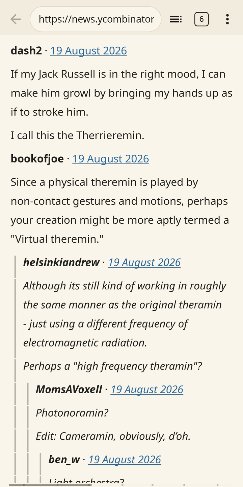
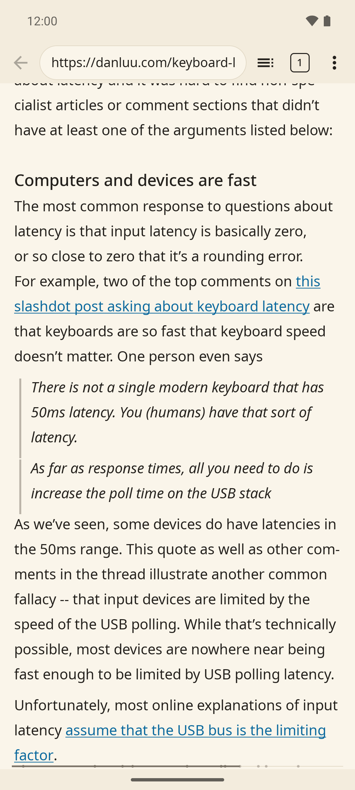
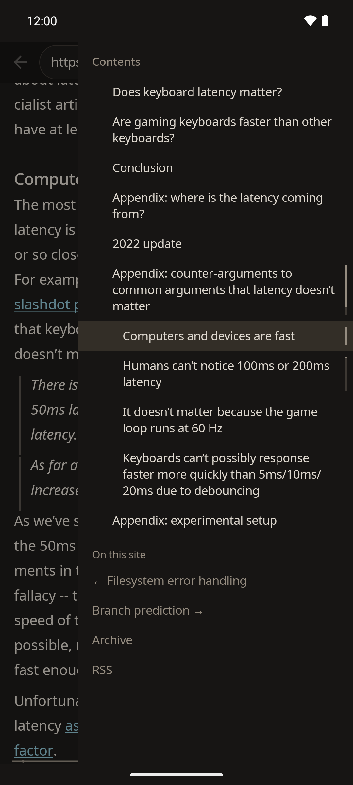

<p align="center">
  
</p>

# Brevier

A browser for reading. Brevier downloads a page, turns it into clean text on your own
computer, and sets it in the typography you chose — not the one the site chose.

- **Articles** without scripts, site styles, pop-ups or ads.
- **Documentation** straight from git repositories: `gh:owner/repo` opens its README.
- **Feeds** — RSS, Atom and JSON Feed — as lists of links.
- **Search** from the address bar.

There is no JavaScript engine and no site CSS. The site decides the words; you decide how
they look. Inside, every page becomes Markdown, made with existing libraries
(`dom_smoothie`, `htmd`) — but the Markdown is plumbing, not the product. The product is
the reading window.

Why it is built this way is in the [manifesto](MANIFESTO.md); what comes next is in the
[roadmap](ROADMAP.md). A short tour with pictures is at
[brevier.bizibah.com](https://brevier.bizibah.com/).

**Status: early.** Brevier runs on Linux and Windows, as a GTK window, and on Android, as a
native app over the same core. Builds are in
[Releases](https://github.com/gurov/brevier/releases/latest); the Android app is also on
[F-Droid](https://f-droid.org/packages/io.github.gurov.brevier/), and the source on
[crates.io](https://crates.io/crates/brevier).
Screen readers are known to work on Linux only (see
[What it does not do](#what-it-does-not-do)).


## Install

**Linux, Flatpak.** The runtime brings GTK, so any distribution will do. Brevier keeps a
Flatpak repository of its own, and installing from it brings the updates too:

```sh
flatpak install --user https://brevier.bizibah.com/flatpak/brevier.flatpakref
flatpak run io.github.gurov.brevier https://example.com/article
```

GNOME Software and Discover open the same
[`brevier.flatpakref`](https://brevier.bizibah.com/flatpak/brevier.flatpakref) with a
click. After that `flatpak update` (or the store app) brings each new version. The
repository is signed, and the key comes with the `.flatpakref`: an update signed by
anyone else, or older than what you have, is refused. The key's fingerprint:

```
6B4E DDB5 9942 1591 7552  C75F CE2B EBF8 1389 1B3B
```

Each release also has the
same app as one file,
[`brevier.flatpak`](https://github.com/gurov/brevier/releases/download/v0.19.1/brevier.flatpak)
(`flatpak install --user ./brevier.flatpak`). Files released after 0.14.0 update from the
repository as well; Brevier installed from an older one does not — run
`flatpak uninstall --user io.github.gurov.brevier` (your data stays) and install it again
from the repository.

The first install also downloads `org.gnome.Platform//49` from Flathub if you don't have
it — about 400 MB, shared with other Flatpak apps. In the sandbox your data lives in
`~/.var/app/io.github.gurov.brevier/`, saving goes through the system's file dialog, and
local files (a `.md`, a saved feed) can't be opened.

**Linux, tarball.** For a system that already has GTK 4 (`libgtk-4-1` on Debian and
Ubuntu) and no wish for a sandbox:

```sh
tar xf brevier-0.19.1-x86_64-linux.tar.gz
cd brevier-0.19.1-x86_64-linux && ./install.sh
```

`install.sh` installs into `~/.local`, needs no root, and `--uninstall` removes it again.

**Linux, crates.io.** With Rust 1.88 or newer and GTK 4.10 or newer with its development
files (`libgtk-4-dev` on Debian and Ubuntu):

```sh
cargo install --locked brevier --features ui
```

This builds the window, `brevier-ui`, and the command line, `brevier`, into `~/.cargo/bin`;
the same command updates them. `--locked` keeps the dependency versions the release was
tested with. No desktop entry or icon is installed this way;
[CONTRIBUTING.md](CONTRIBUTING.md#building) shows how to add them. The command line alone
needs no GTK: `cargo install --locked brevier --features save`.

**Windows** 10 or 11, 64-bit. Download
[`brevier-0.19.1-windows-x86_64-setup.exe`](https://github.com/gurov/brevier/releases/download/v0.19.1/brevier-0.19.1-windows-x86_64-setup.exe)
and run it. It installs for you alone, with no administrator rights, and puts Brevier in the
Start menu; remove it under Installed apps. The installer is not signed yet, so Windows
shows "Windows protected your PC" first: choose **More info**, then **Run anyway**. To run
Brevier without installing it, unpack
[`brevier-0.19.1-windows-x86_64.zip`](https://github.com/gurov/brevier/releases/download/v0.19.1/brevier-0.19.1-windows-x86_64.zip)
anywhere and start `bin\brevier-ui.exe`; `bin\brevier.exe` is the command line.

**Android** 7.0 or later, 64-bit ARM. Install it from
[F-Droid](https://f-droid.org/packages/io.github.gurov.brevier/), which keeps it up to
date. Or download
[`brevier-0.19.1-arm64.apk`](https://github.com/gurov/brevier/releases/download/v0.19.1/brevier-0.19.1-arm64.apk)
on the phone and open it; Android asks once to allow installs from the app you opened it
with. Updates install over it as long as they are signed with the same release key:

```
30:A4:32:B8:2F:3E:F0:FC:E5:F4:68:1F:D7:F9:FE:20:5F:4B:17:A2:F4:34:19:C2:45:0C:A2:6B:E6:8D:34:80
```

F-Droid builds Brevier from source and publishes this same APK, signed with this key, only
when its build matches ours byte for byte. So an install from either place updates from the
other. A new version reaches F-Droid a few days after it appears in Releases.

**The command line alone**, one file with nothing to install beside it: no GTK, no OpenSSL,
on Linux statically linked, so any distribution will do. From 0.15.0 on, every release has
an archive for Linux on x86_64 and on 64-bit ARM, for macOS (one file for Apple silicon and
Intel) and for Windows, always at the same address:

```sh
curl -L https://github.com/gurov/brevier/releases/latest/download/brevier-cli-x86_64-linux.tar.gz | tar xz
./brevier-cli-x86_64-linux/brevier https://example.com/article
```

The others are `brevier-cli-aarch64-linux.tar.gz`, `brevier-cli-macos.tar.gz` and
`brevier-cli-windows-x86_64.zip`. The macOS file is not signed: downloaded with a browser,
it needs `xattr -d com.apple.quarantine brevier` once; with `curl` it does not.

Every release is built by CI from its tag, and `SHA256SUMS` lists the checksum of each
file. To build from source, see [CONTRIBUTING.md](CONTRIBUTING.md#building).

**Make it your browser.** Brevier registers for `http`, `https` and `feed://` links and
for Markdown and feed files, so it shows up in "Open with". It doesn't make itself the
default; if you want that:

```sh
xdg-settings set default-web-browser io.github.gurov.brevier.desktop
```

On Windows the installer offers Brevier the same way; choose it under Settings → Apps →
Default apps.

`Ctrl+O` still hands any page to your other browser. On Android, Settings has
**Make default**. If the menu shows Brevier without its icon, log out and back in — the
desktop shell cached its icon list before the icon was installed.

## Use

`brevier-ui <url> [<url>…]` opens a window, one tab per address. An address sent while
Brevier is running — from the command line or a link clicked in another app — opens as a
tab in the window you already have. Starting it with no address opens a new window.

The same core works on the command line:

```sh
brevier https://example.com/article     # Markdown on stdout
brevier https://example.com/feed.xml    # an RSS, Atom or JSON feed, as a list of links
brevier gh:rust-lang/book               # a repository's README
brevier gh:rust-lang/book/src           # the README of a directory inside it
brevier gh:rust-lang/book/src/          # …or what the directory holds, listed
brevier gl:owner/repo                   # the same for GitLab
brevier --docs gh:rust-lang/book        # entry points into its documentation
brevier --check <url> [<url>…]          # score pages for a reader without scripts
brevier --links <url>                   # the article's outgoing links
brevier --nav <url>                     # the site's own menu and footer links
brevier --raw <url>                     # no extraction, the whole page
brevier --html <url>                    # the extracted HTML, before conversion
brevier --stdin <url> < page.html       # HTML you already have; the url is
                                        # where it came from, for its links
brevier --save <url>                    # save to a file instead of stdout
brevier brevier:history                 # what you have read, by day
brevier brevier:archive                 # a copy of every article you read
brevier "brevier:archive?q=latency"     # …searched for words
brevier brevier:archive/<host>/<file>   # one copy, printed as plain Markdown
brevier brevier:wayback/<url>           # the Wayback Machine's latest good copy
brevier "borrow checker"                # not an address: a search
brevier "?danluu.com"                   # a leading ? searches for anything
```

A GitHub or GitLab file URL, a `feed://` link, a local `.md` file or a saved feed work too.
`--save` writes a `.md`, or a `.zip` with an `images/` folder when the page has pictures;
`-o` sets the file name. Without `-o` it never overwrites an existing file.

Exit codes, for scripts: 1 bad address, 2 network, 3 HTTP status, 4 content type,
5 nothing extracted, 6 conversion (or a broken feed).

A chapter of the Rust book, read straight from the repository
(`gh:rust-lang/book/src/ch03-02-data-types.md`), with the book's documentation on the
shelf:


### Check your own site

`--check` scores a page from 0 to 100 for a reader that runs no scripts. It says what to
change and how many points each finding cost, and exits with an error below `--min`
(80 by default). In the window the same report is in the menu, **Check this page**.


In CI it is a GitHub Action:

```yaml
- uses: gurov/brevier@v0.19.1  # a release tag, or @main
  with:
    urls: |
      https://example.com/
      https://example.com/docs/getting-started
    min: 80                      # fail the job below this
    badge: brevier-check.svg     # optional: an SVG with the lowest score
```

The reports go to the job summary; the lowest score is the step's `score` output.

## Keys

| | |
|---|---|
| `Enter` | open the address |
| `Space` / `Backspace`, `PageDown` / `PageUp` | page down / up |
| arrows, `Home` / `End` | line, top, bottom |
| `Tab` / `Shift+Tab` | mark the next / previous link |
| `Enter` / `Ctrl+Enter` on a marked link | follow it / open it in a new tab |
| `Alt+←` / `Alt+→` | back / forward |
| `Ctrl+L` | go to the address bar |
| `Ctrl+R`, `F5` | reload, downloading the page afresh |
| `Ctrl+T` / `Ctrl+W` | new tab / close tab |
| `Ctrl+Tab`, `Ctrl+PageUp` / `PageDown` | switch tabs |
| `Ctrl+F` | find on page |
| `Ctrl+H` | history |
| `Ctrl+Shift+F` | search what you've read |
| `Ctrl+D` | bookmark the page, or remove the bookmark |
| `Ctrl+Alt+M` | write a note on the selected passage |
| `Ctrl+Shift+M` | show or hide notes beside the text |
| `Ctrl++` / `Ctrl+-` / `Ctrl+0`, `Ctrl`+wheel | zoom in / out / reset |
| `Ctrl+S` | save the article |
| `Ctrl+O` | open the page in your other browser |

With the mouse: `Ctrl`+click or middle-click opens a link in a new tab, middle-click on a
tab closes it, and the back and forward buttons go back and forward. Hovering a link shows
where it goes. Settings, history and bookmarks are in the menu at the top right.

## What you get

**Reading**

- **Your typography, the same on every site.** Out of the box: 16.5 pt Noto Sans, about
  65 characters per line, airy leading, headings lighter than the text. Settings offer
  four ready-made styles — Brevier, Book (your system's serif, justified), Large print and
  Compact — and under **Fine-tune**, the face (the built-in Noto Sans, or your system's
  serif or sans), the size, the line length and the line spacing, once for every site;
  zoom stays on top, for the run.
- **Hyphenation by the page's language** (English and Russian are built in); in Russian
  and Czech no line ends on a one-letter word. Copy and find-on-page see the plain text,
  tables included: find goes through their cells, and a copied table pastes as rows of
  tab-separated cells.
- **Justified text** as a setting: paragraphs get a straight right edge; headings, lists
  and code stay ragged.
- **Ivory paper** instead of glaring white, and a warm dark theme. **High contrast** for
  sharper letters: black on white paper, or white on black in the dark theme. Until you
  choose, Brevier follows your system's contrast setting (Linux, Android 14 and later,
  Windows).
- **Zoom (67–200%) scales the whole layout**, so a line still holds about 65 characters.
- **Fonts are built in** — Noto Sans and Noto Sans Mono — so a page looks the same on every
  system, unless you pick your system's serif or sans.
- **Poems keep their lines and stanzas.**

**Finding your way**

- **The shelf on the right** lists the repository's documentation, your notes on the page,
  its contents (the section you are reading is marked), the site's feeds and the site's own
  menu. Drag the divider to resize it.
- **Back and forward return to the same spot**, instantly, without loading the page again.
- **Pick up where you stopped.** A page you read for more than ten minutes remembers where
  you were and what you have read. Open it again and the status line offers **Continue
  from 43%**. The shelf shows how much of each section you have read, and a thin bar under
  the text shows how far you are, with a dot for each section.
- **Notes on a page.** Select a passage and choose **Highlight** to mark it, or **Note** to
  write a few words next to it. Open the page again and the marks are where you left them,
  even when the site has changed around them: a note keeps its quote, not a position. The
  shelf lists the page's notes above its contents, the bar under the text shows them as
  small squares, and **Your notes** in the menu lists them all, by page. A saved article
  carries its notes at the end, and a page with notes keeps its copy for good.
- **Notes in the margin, with your pictures.** In a wide window the notes stand in a margin
  between the text and the shelf, each level with its passage and joined to it by a thin
  line, as comments are in a word processor; where there is no room, they stand under
  their paragraph. Click a note's words to edit them in place. A map or a diagram found
  elsewhere goes next to the passage: paste it into the note, drop it on the note, or pick
  a file — it is your picture, marked as yours, never part of the article.
  `Ctrl+Shift+M` hides the notes and leaves the highlights.
- **Notes go out as Markdown.** **Export this page's notes** or **Export all notes**, in
  the menu, writes each quote with a link straight to its place on the page, your words
  and your pictures — Markdown that Obsidian and similar tools read as it is: a `.zip`,
  or a `.md` with an `images/` folder beside it.
- **Next page.** A page that names the one after it — a series, a book chapter, a thread's
  next page — ends with a **Next:** line, and `Space` at the very end goes there.
- **A new tab shows the five pages you read last.**
- **Tabs come back** after you close the window; only the visible one loads at start.
- **History and bookmarks**, and the address bar suggests pages you have read.
- **Every article you read is kept as your copy**, a Markdown file, so you can read and
  search it after the site has changed or gone; compressed, or plain `.md` for other
  programs to open. The history links each page to
  its copy; a bookmark keeps its copy for good. **Search what you've read** is in the menu
  (`Ctrl+Shift+F`), and `brevier:archive` lists every copy.

**Any kind of page**

- **A list of links** — a blog's front page, a section of a site — is shown as a list, and
  the status line says so.
- **A news site's front page and its sections read as their headlines**, in the page's
  order, rather than as the one story — or the site's footer — an article extractor would
  pick out of them.
- **Pages that never say what encoding they are in**, common on the older web, still read
  right: Brevier guesses the encoding from the text, as Firefox does.
- **Feeds** open as lists of entries with date, author and a short summary — from an
  address, a `feed://` link or a file. A feed of comments on one page (a reddit thread,
  WordPress comments) reads as a thread.
- **Hacker News, Lobsters and Discourse forums read as threads.** The story, then every
  comment with its author and day, replies indented; a reply too deep to indent says whom
  it answers. The front page and the other lists of stories are lists of links, with
  points and a link to the comments. A Discourse forum recent enough to serve Markdown is
  read as it serves it.
- **Habr articles come with their comments.** Habr's page fetches them with a script;
  Brevier makes that same one request and sets them under the article in the same thread
  look. Every comment keeps its anchor, so a link to a comment opens at it. A Habr
  comments page on its own reads as the thread.
- **Rust documentation reads whole.** docs.rs and the standard library's pages are read
  from rustdoc's own layout: signatures as highlighted code, every method and
  implementation, none of the buttons.
- **Tables of labels and values** — Wikipedia's infoboxes, MDN's summaries — keep their
  labels: each row becomes a line, **Developer:** The Rust Team.
- **Repository folders can be listed:** end the address with a slash
  (`gh:owner/repo/docs/`) or use **Files in this directory** on the shelf.
- **Search.** Anything that is not an address goes to DuckDuckGo Lite, and the results
  come back as a list of links. A leading `?` forces a search.
- **Images load right away, and one switch turns them off** — without JavaScript, the
  image decoder is the main thing left to attack. A click on a picture saves it as the
  site sent it, byte for byte, or opens it in your browser; the phone can share it too.
- **Pages read in the last week open without downloading**, from a cache on disk.
  `Ctrl+R` fetches a fresh one. Lists of links are always fetched, since what's new is the point.
- **Sites that serve Markdown are read exactly as written**, with no extraction. Brevier
  speaks CommonMark with GitHub's extensions; footnotes and GitHub alerts (`> [!NOTE]`)
  are kept.
- **Plain `http` pages are marked "Not secure".** There is no padlock: people read it as
  "this site is trustworthy", when it only means "the connection is encrypted".
- **A page that can't be shown says why** and offers **Open in your browser**. If you read
  it before, it offers **your copy** from the archive too. If the page is gone, it offers
  **the Wayback copy**: the latest one the Wayback Machine saved of the page itself, not
  of its 404.

Notes in the margin of the essay at the top of this page, one with a sketch of the reader's own:


A feed in Brevier — the Rust blog's, `blog.rust-lang.org/feed.xml`:


A Hacker News thread on the phone, every reply under the comment it answers:

<p align="center">
  
</p>

## On the phone

The Android app is a second front-end over the same core. It draws the article as native
text — not in a WebView — with the same typography and colours as the window.

- Tabs, the shelf, find on page, zoom (from the menu or with a pinch), saving, history,
  bookmarks, settings, the dark theme, and a session that comes back.
- It can be your default browser, and **Open in your browser** still finds the others.
- It opens links, shared text, `feed://` links and Markdown or feed files from other apps.
- A long press on a link opens it in a new tab, copies it, or sends it to your browser.
- **Highlight** and **Note** sit in the selection menu next to Copy; a tap on a marked
  passage edits or removes its note. A note's words and pictures stand right under its
  paragraph; a picture comes from the system photo picker, and big camera photos are made
  smaller. **Share this page's notes** sends them out as Markdown.
- A tap on a picture saves it to your gallery or shares it.
- A very long page — a whole novel — shows its first screen at once.
- **The bar slides away while you read**: it follows your finger up and down without moving
  the text, and stays put at the top and end of a page, on short pages, while you type,
  search or select, and with TalkBack or Switch Access on. A setting keeps it in place.
- With a keyboard attached, the window's shortcuts work, `Alt+←` / `Alt+→` included.

The maintainer uses it every day. It hasn't been tested with TalkBack yet.

<p align="center">
  
  
</p>

## How well it works

When we last measured our test set — 108 live pages, on 11 September 2026 — **80 read
well (74%)**. Of the 89 pages that reached the extractor, 80 read well (90%); the other 19
were blocked before that — by certificates, 403/401 responses, or anti-bot walls.

These are our own numbers. The rubric (`corpus/RUBRIC.md`) is ours, the marking is done
by hand, and we relaxed the rubric once after seeing the results; the strict reading gave
56%.

On an outside benchmark (`scrapinghub/article-extraction-benchmark`, 181 pages) the whole
pipeline scores **F1 0.929**, and extraction alone 0.951 — next to 0.947 for Readability.js
and 0.958 for trafilatura in the same table. That set is news; Brevier is aimed at long
reads, documentation and threads.

On 295 news sites (9 October 2026: three fresh articles from each site's feed, checked
against the headline and summary the feed gives), 671 of the 712 articles Brevier could
reach read well (94%); another 91 were closed to it.

On 211 news front pages (copies saved on 9 October 2026), 95% of the newest headlines from
each site's feed that are in the page's HTML reach the reader; before 0.13.0 it was 42%.

Extraction breaks as sites change their markup. Keeping up with that never ends.

## What it does not do

- **JavaScript** — never, in any form.
- **Site CSS** — never; the typography is yours.
- **Forms, logins, cookies** — no. Here the web is read-only, on purpose.
- **Single-page apps** — they degrade honestly, and **Open in your browser** is one click
  away.
- **Video, audio, extensions** — no.
- **AI by default** — no. Pages are read by plain rules: the same page always gives the same
  text, and every word of the article is the author's. If models ever come — a small
  specialised one for pages the rules can't read, say — they will be a separate module, off
  until you turn it on, with whatever they produce marked as theirs.
- **Screen readers outside Linux** — GTK's accessibility works only on Linux: on Windows a
  screen reader doesn't see the window, and that is one reason there is no macOS build yet.
  The Android app uses native text, which TalkBack should read, but that hasn't been tested.
- **Privacy** — not promised. Sites can track you as they always could.

## Your data

History, open tabs and bookmarks are plain text, one line per entry:

```
~/.local/share/brevier/history.tsv     # what you have read
~/.local/share/brevier/session.tsv     # the tabs you left open
~/.local/share/brevier/bookmarks.tsv   # the pages you kept
~/.local/share/brevier/archive/        # a copy of every article you read
~/.local/share/brevier/reading.tsv     # where you stopped in long pages
~/.local/share/brevier/notes.tsv       # your highlights and notes
~/.local/share/brevier/notes/          # the pictures in your notes
```

The archive holds one file per page, `<host>/<date>-<title>.md.lz4`: Markdown with a short
header (title, address, when you read it), compressed in the standard LZ4 format, so
`lz4 -d` opens it without Brevier. **Keep the copies as plain files**, in Settings, writes
new copies as plain `.md` instead, which Obsidian, desktop search or another reader open as
they are, at about twice the space; the copies kept before stay as they were, and Brevier
reads both. On the phone copies stay compressed: no other app can see the app's own
folder anyway. A copy stays as long as its line in the history, and a
bookmarked page, and a page with notes, keeps its latest copy for good, even through
**Forget everything**. A switch
in Settings stops new copies.

Settings are in `~/.config/brevier/settings.tsv`. The cache — the fonts, and week-old
copies of pages (up to 64 MB of text and 256 MB of images) — is in `~/.cache/brevier`.
The usual `XDG_*` variables move these folders, and `BREVIER_DATA_DIR` moves them all.
On Windows all of it is in `%LOCALAPPDATA%\Brevier`; on Android, in the app's own storage.

There is no database: delete a line to forget a page. **Forget everything** in Settings
clears the history, the cache of pages and the archive, and keeps your bookmarks and notes
with their copies, and your tabs. Only the window writes these files; `brevier <url>` on the command
line keeps no history.

## On the network

- **Not a crawler.** Brevier fetches the page you opened and what it needs to show it: its
  images, a Markdown version if the site offers one, a few probes to find a repository's
  documentation. It never walks a site.
- **Markdown first.** Every request asks for `text/markdown` before HTML, and
  `<link rel="alternate" type="text/markdown">` is followed when a page has one.
- **Very few per-site rules.** reddit is read through its `.rss` feeds (its pages are empty
  without JavaScript); Hacker News, Lobsters and Discourse forums are read from their own
  markup, since the general extractor drops the author of every comment, or every comment
  but one; Habr's comments are asked for at the address its own script uses, one more
  request to habr.com for an article that has any; rustdoc pages are read from their main
  column;
  royallib's books open part by part; DuckDuckGo Lite results are unwrapped from its click
  tracker. Your search queries go to DuckDuckGo.
- **The Wayback Machine is asked only when you press the button.** A page that is gone
  does not send its address to archive.org by itself.
- **An honest User-Agent:** `Brevier/0.1`. On our test set, pretending to be a browser lost
  seven pages to anti-bot 403s and won none.
- **TLS trust comes from your operating system** (`rustls` with
  `rustls-platform-verifier`). There are no bundled certificates and no way to skip the
  check. On Android, revoked certificates are refused too, and so is a site whose
  revocation list can't be fetched.

## Contributing

Bug reports and patches are welcome. How the code is laid out, how to build it and what a
change needs before it is merged are in [CONTRIBUTING.md](CONTRIBUTING.md); the plans are
in the [roadmap](ROADMAP.md) and in the issues labelled `roadmap`.

## License

MIT OR Apache-2.0, at your option.

The bundled fonts are under the SIL Open Font License; `assets/fonts/OFL-NotoSans.txt`
must travel with any copy you distribute.
